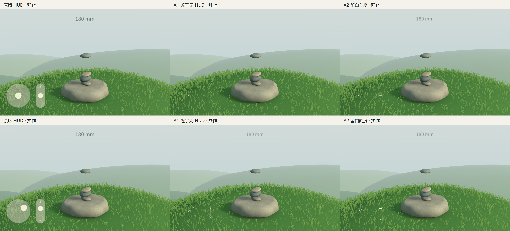
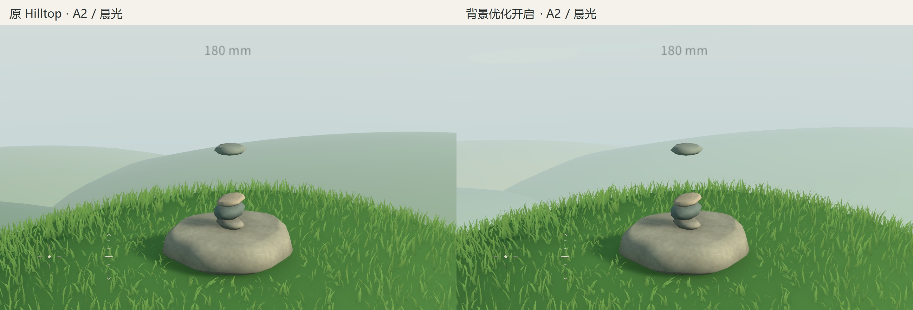

# Hilltop：原场景 UI 与独立背景研究

> **基线限制：此分支单独检出不能预览实验。** 原 `Assets/Herlilan/Hilltop/` 基线尚未提交到任何已核查的 origin 分支。本提交不包含它，也不包含 ZenTriptych。研究代码默认由 `HERLILAN_HILLTOP_STUDIES` 条件编译保护；缺少基线时不会引用不存在的 Hilltop 类型。两张图片是完整本地基线上已经完成的真实 Unity 实录，不代表此分支已自带该场景。

## 目标与范围

先固定原 Hilltop 布景、灯光、机位和石堆，只比较原 HUD 与两种 UI；再保持相同 UI 和晨光，单独比较背景开关。没有用纸庭、黑盒或三套替代场景来测试 UI。

本提交仅包含研究代码、说明、必要的 Unity `.meta` 与两张对照图，不修改原 Hilltop、共享玩法、输入、当前有效塔高计算或项目设置。默认不替换正式 HUD，也不自动启用实验。实验入口面向 **Unity Editor Play Mode**。

## 前置条件与缺失基线

基于 `codex/issue-31-desktop-keyboard` 的 `0ac0dcd1abb29d14d40d82514468a24fca6dfe4e`。该版本已有共享 `RockBalancing.Runtime` 与所需输入 API；2026-11-22 核对的全部 origin 分支均没有 `Assets/Herlilan/Hilltop/`。

预览需要团队另行提供并授权合入完整 Hilltop 基线（包含原 GUID 的 `.meta`），至少包括：

| 类别 | 必需路径（相对 `Assets/Herlilan/Hilltop/`） |
| --- | --- |
| 原场景 | `Scenes/Hilltop.unity` |
| 脚本/程序集 | `Runtime/Herlilan.Hilltop.asmdef`、`HilltopScene.cs`、`HilltopInterface.cs`、`HilltopLighting.cs`、`HilltopGeometry.cs`（脚本均位于 Runtime） |
| 材质 | `Materials/Distant_sage_0.mat` 至 `Distant_sage_8.mat`，以及 `Meadow_breeze.mat`、`Mossy_hill.mat`、`River_stone.mat`、`Soft_morning_sky.mat`、`Weathered_limestone.mat` |
| 网格 | `Meshes/Grass_0.asset` 至 `Grass_11.asset`、`Hill.asset`、`Platform.asset`、`Distant_mound.asset` |
| 渲染设置 | `Settings/HilltopPipeline.asset`、`HilltopRenderer.asset`、`HilltopVolume.asset` |
| Shader | `Shaders/HilltopMeadow.shader`、`HilltopSky.shader`、`HilltopStone.shader` |

场景 GUID 依赖递归核查发现 **37 个未在目标远端跟踪的直接/传递资产**；上表另列出代码调用依赖的运行时脚本和程序集。没有将这些本机未跟踪文件纳入本次提交。

## 启用、切换与恢复

1. 先补齐上述基线，保持其 GUID 和依赖；Unity 版本为 **6000.3.20f1**。
2. 运行 **Herlilan → Hilltop Studies → Check prerequisites**。缺少基线时只报告缺失路径，不改变配置。
3. 文件齐备后，在当前目标的 Player Settings / Scripting Define Symbols 添加 `HERLILAN_HILLTOP_STUDIES`，等待编译。此符号不能代替缺失基线。
4. 打开原 `Assets/Herlilan/Hilltop/Scenes/Hilltop.unity`，运行 **Enable experiments (original HUD first)**，进入 Play。

| 操作 | 效果 |
| --- | --- |
| F6 | 原版 HUD |
| F7 | A1「近乎无 HUD」 |
| F8 | A2「留白刻度」 |
| F9 | 独立开关背景优化 |

相同操作也有 Editor 菜单入口。原 1–4 光照切换和 L 轮播继续有效。首次进入仍为原 HUD，背景优化关闭。退出 Play 撤销运行时覆盖；**Disable experiments for next Play** 取消下一次挂载。移除编译符号可停用研究代码。

## UI 对照

上排静止，下排操作；列顺序为原版、A1、A2。六张原始 1440×900 Unity 截图仅加标题拼接，背景优化均关闭，统一晨光、机位和同一组石头，当前有效塔高为 180 mm（A1 空闲按设计隐藏高度）。

- **A1「近乎无 HUD」**：小菱形/短定位符提示移放，上下箭头提示升降。悬停、触碰或操作时展开方向反馈，松手后淡回。高度仅在变化、稳定结束或操作后短暂显示。
- **A2「留白刻度」**：常驻少量十字刻线与浮动菱形；升降使用分离刻度与横向游标。没有圆环、胶囊或底板，高度为低调细字。

两案复用原 DragPad、原 114×114 / 45×114 区域、移动/升降委托与取消路径。新增图形不接收射线，不缩小热区。

设计方向参考 [Journey](https://thatgamecompany.com/journey/)、[ABZÛ](https://abzugame.com/Site)、[GRIS](https://nomada.studio/gris-game/) 的第一方展示，借鉴环境主导与简洁提示；这是本实验的设计解读，没有复制标志，也不声称这些游戏使用虚拟摇杆。

## 独立背景对照

远丘采用雾蓝、浅青和微暖的低对比层次，降低远丘起伏，加入缓慢移动的淡云，并轻微增强原草风幅度。关闭后恢复原远丘比例、材质属性和草材质。

不替换底座接触区域、石头、碰撞、机位或太阳/天空/雾/Volume 控制；原四套动态光照继续工作。没有额外云影或新光源。

## 验证结果与限制

在完整本地 Hilltop 基线的隔离副本中运行 Unity Editor Play Mode，使用真实 **D3D11 / RTX 4080**，没有使用 `-nographics`。原场景文件哈希保持不变；画面没有用概念图替代。

**54 项自动断言通过**，涵盖：
- 原 Hilltop 场景挂载、三次叠放、当前有效塔高；
- 三种 UI 的热区及输入委托保持、场景/灯光/材质不变；
- 经原 DragPad 指针处理函数实际移动与升降、重复操作、松手与取消后恢复；
- A1 悬停展开、空闲淡回及高度隐藏，切回原 HUD；
- 背景独立开关、近景保留、四套光照兼容及关闭恢复。

已视觉核对六张 UI 实录和背景前后图。**真实 OS 键鼠、真实触摸、OS 失焦事件未测试**。自动输入使用脚本构造的 PointerEventData；失焦检查调用既有 CancelForFocusLoss 与呈现清理入口，不等于实际切换窗口。

**整轮结果仍为 Errors:1 / FAIL，并非全绿。** Unity 自带 Search 索引在启动时可复现 `ArgumentOutOfRangeException`，路径为 `SearchDatabase.EnumerateAll → GetDefaultSearchDatabase → SearchInit.IndexationOnStartup`。它没有阻止玩法回放和截图，但没有被修复、过滤或隐藏；本实验未改 Search 设置或索引。

源码的条件编译封装与无基线入口另做编译检查。上面的 54 项运行结果来自完整本地基线；干净检出本分支缺少 Hilltop 时不具备运行这些检查的条件。

有基线并启用符号后，可运行 **Herlilan → Hilltop Studies → Capture original Hilltop comparisons** 复现。该入口要求 Editor 未在 Play 且当前场景无未保存改动；完成后恢复原场景，并在本目录 Review 下生成本机报告和单图。本提交只保留上面两张对照图，不包含临时日志、隔离项目或个人机器路径。

