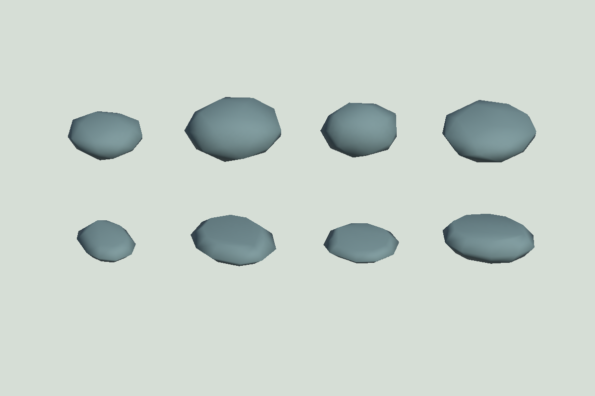

# #22 扁石生成与固定种子对照

日期：2026-11-11。基线：`201000225d9d02c5dfc7235e7264807f5024b42f`。
需求：[实现票 #22](https://github.com/JunduoLiu/RockBalancing/issues/22)、[增量规格 #27](https://github.com/JunduoLiu/RockBalancing/issues/27)。

## 生成规则与默认值

- 扁石概率 **85%**，另 **15%** 沿用基线的不规则凸鹅卵石算法。
- 扁石长度参数仍为 **0.15–0.23 m**；宽度为长度的 **66%–98%**；厚度为长度的 **18%–28%**（约 **27–64.4 mm**）。比例指全厚度/长度参数，不是半轴比例。
- `GameBootstrap.StoneShapes` 可在 Inspector 调整概率和厚度上下限。运行时厚度限制在长度的 12%–40%，反向上下限按下限收敛；概率限制在 0–1。
- 扁石由三个同心相似凸十边形环组成：中环为外轮廓，上下环缩至中环的 68%–82%，形成真实平面支撑面和斜切侧面。随机角度、宽厚、支撑面尺寸和水平朝向保持连续变化；每颗生成后不再变形。
- 初始上下支撑面朝向竖直方向，随机水平朝向不把扁石立起来。玩家仍可自由旋转。
- 可见和碰撞使用同一封闭凸网格（30 顶点、56 三角形），质量仍为网格体积 × 2400 kg/m³，下限 0.05 kg。摩擦、阻尼、求解器和碰撞检测模式均沿用基线，没有吸附、自动扶正或固定。

Unity 临时预览场景渲染，种子 1000–1003；上排强制使用基线形状、下排强制扁石，显示同种子下的形状差异。图示不用于推断随机占比，生成后已清理预览场景。

## 可复现方法

在 Unity **6000.3.20f1** 的 Play Mode 运行 `RockBalancing.Tests.FlatStoneTests.FixedSeedDistributionAndStackingComparison`。结果输出到 Console 和项目内 `.scratch/issue22-comparison.txt`。

所有方案使用同一组 12 个序列：`seed = 1000 + 10 × trial + index`，`trial=0..11`、`index=0..4`，每个方案 60 颗。概率为零时直接使用未改变的旧生成算法；选择扁石的抽签使用独立随机流，不改变保留下来的旧种子形状。

每个序列重开，在同样的 1 m 方形底座上连续释放 5 颗。朝向不作人工优化，水平 x 交替为 −12/+12 mm、z=0，石头底部距当时塔顶 6 mm。每次推进 150 个 20 ms 物理步，最后再推进 100 步。独立物理场景避免场景现场干扰，不改变全局物理时间步。

“滑移或移除”表示最终水平位移超过 20 mm 或已触地移除。“五层”依据从底座沿向上接触链的层数，不能把五颗倒散在底座上算作五层。记录实验结果，不对这些比例作自动通过阈值；它们不代表手机玩家成功率。

## 本轮实测

厚度和质量均为该方案全部 60 颗（包括不规则石）的平均值。

| 扁石概率 | 扁石厚度比 | 实际扁石 | 平均厚度 mm | 平均质量 kg | 滑移或移除 /60 | 五层 /12 | 平均层数 |
| --- | --- | --- | --- | --- | --- | --- | --- |
| 基线 0% | 不适用 | 0 | 113.00 | 3.739 | 45 | 0 | 2.25 |
| 50% | 18%–28% | 30 | 77.61 | 2.739 | 39 | 0 | 3.00 |
| 70% | 18%–28% | 45 | 61.30 | 2.341 | 26 | 4 | 3.75 |
| **85%** | **18%–28%** | **52** | **52.47** | **2.073** | **15** | **7** | **4.17** |
| 85% | 12%–20% | 52 | 41.03 | 1.599 | 15 | 8 | 4.50 |
| 85% | 24%–34% | 52 | 62.32 | 2.481 | 26 | 5 | 3.67 |

选择 85% 让可用支撑面更常见，同时保留不规则石头。18%–28% 比更厚方案滑移少；比最薄方案保留更多厚度与质量，滑移结果相同、五层只少一个序列。最薄方案仍保留为可调范围，并专门验证最小厚度，不凭这批小样本宣称某组参数全局最优。高度仍按现场真实网格测量，扁石更薄不意味着同颗数必然更高。

## 行为验证

`FlatStoneTests` 验证两类形状的尺寸、闭合边、凸性、正体积、有效支撑面积、显示/碰撞同网格、体积质量和初始朝向。最薄 12% 石头在真实物理中停稳休眠、无超过 2 mm 的底座穿透、继续模拟无超过 1 mm 漂移；明显失衡掉落、高处偏心撞击唤醒并扰动已有塔体。`PhysicsRulesTests` 补充生成薄石在正常游戏会话中的移动阻挡和释放前重叠复查。

新增边界测试曾复现一次真实拒绝遗漏：插值刚体的物理位置已经进入待摆石头，但 Transform 仍显示上一帧位置。广相查询发现障碍后，旧代码用滞后的显示姿态计算穿透，错误允许释放。现改为以刚体当前物理位置/旋转计算障碍碰撞体姿态（保留子碰撞体偏移），与广相查询一致；不改变玩家摆放控制或物理参数。

最终回归（2026-11-11）：现有 Unity 6000.3.20f1 中 `RockBalancing` Play Mode **25/25 通过，0 失败、0 跳过**；`node --test tools/share.test.cjs` **9/9 通过**。六组固定种子结果在最终回归中复现。生成薄石的动态重叠测试在修复前失败、修复后通过，其余回归保持通过。测试后恢复 `Balance` 场景，未保存或覆盖用户场景。

未运行：本轮 Web 构建/重新发布、iPhone + Chrome 实机试玩。桌面 Unity 自动化不替代手机手感验收；本票不宣布 #26 完成。公开测试版仍为之前的构建，不包含此变更。
