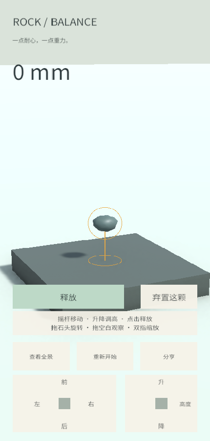

# #23 摇杆、升降与独立释放验证

日期：2026-11-11。基线：`617a9d57d3d8e3200136ac921968e58a061c0d02`。
需求：[实现票 #23](https://github.com/JunduoLiu/RockBalancing/issues/23)、[增量规格 #27](https://github.com/JunduoLiu/RockBalancing/issues/27)。

## 操作与参数

摇杆相对控件中心的偏移持续产生水平速度；独立升降控件持续调整高度。回中或松手立即停止，拖待摆石头只旋转。只有独立“释放”按钮普通释放，空白只观察；独立丢弃、全景、分享和确认重开保留。

`GameInput` 的默认死区为 12%，最大水平速度 0.35 m/s，最大升降速度 0.45 m/s；死区外速度按偏移线性增加，二维输入限制在单位圆内。按帧时间积分，单次最长推进 0.1 s，避免恢复后的长帧造成大跳跃。参数可调。

控件触点在起始位置分配，不参与场景双指缩放。释放和丢弃绑定按下时的待摆石头，同时使用 0.4 s 重复动作保护和多击过滤。换石、释放、丢弃、重开、弹窗、失焦和触控取消都会清空持续输入；旧触点全部结束后，新的操作才可控制待摆石头。

调整与释放继续经过 GameSession 的统一碰撞规则，保留 #22 对动态刚体真实物理姿态的重叠复查。无效释放保留待摆石头并显示提示，不供给下一颗。

## 本轮实测

Unity **6000.3.20f1**，在用户原有 Editor 中运行 `RockBalancing` Play Mode：**35/35 通过，0 失败，0 跳过**（31.19 s）。分享基础回归 `node --test tools/share.test.cjs`：**9/9 通过**。

本轮交互测试共 16 项，覆盖：

- 摇杆死区、持续速度、偏移比例、斜向限速、回中/松手停止；30 和 120 fps 各推进 0.5 s 的位移一致。
- 摇杆/升降同时触摸，水平和高度各自独立，控件不触发缩放；拖石旋转不改变位置。
- 空白轻点、拖动和结束调整不释放；释放按钮正常供下一颗，快速重复点击和旧按钮事件不能释放下一颗。
- 等待异步供石时释放禁用，迟到的供石不接收旧按钮意图。
- 失焦、弹窗、重开、触控取消、释放及丢弃后输入清空，新的操作可恢复控制。
- 动态重叠导致按钮释放失败，待摆和提示保留；抬高后可正常释放。
- 使用可玩场景的升降控件接近支撑面、按钮释放、获得下一颗并继续堆叠两颗；调整不推挤支撑石头。
- 原有全景构图、调整时相机锁定、真实分享图生成和重开失效规则。

其余 19 项回归覆盖 #22 石形和物理、统一会话、当前有效塔高、接触链、弃石、动态重叠和连续供石。

## 测试发现并修复的问题

1. 待摆刚体启用物理插值时，逐帧设置的 Transform 会被旧物理姿态覆盖，造成速度随帧率变化。待摆阶段现关闭插值，释放后恢复插值；不改变已释放石头的物理求解参数。
2. Unity Input System UI 会将某些 `Canceled` 触控送成按钮点击。释放/丢弃按钮现核查原始触点的取消状态，拒绝该点击。该用例修复前失败、修复后通过。

## 验证边界

此次在桌面 Unity 的真实场景入口、EventSystem、模拟鼠标/触控和物理系统中验证。没有执行 Web 重构建/重新发布，也没有执行 iPhone + Chrome 真机验收；公开测试版仍是原构建。桌面证据不代替 #26。本票不实现 #24 三维相机或 #25 完整镜头衔接，不改变现有全景行为。
