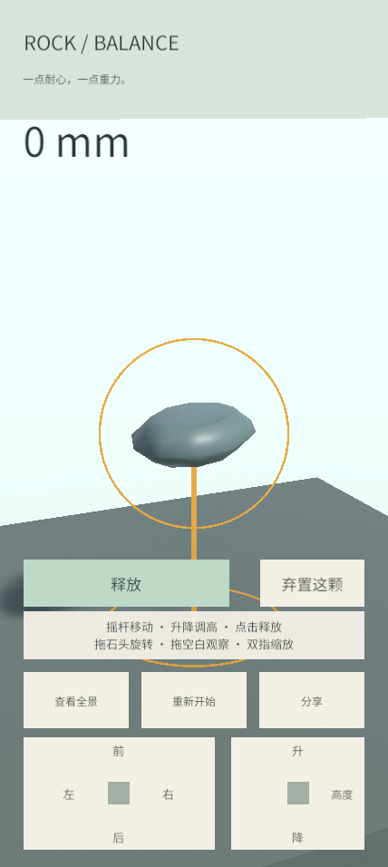
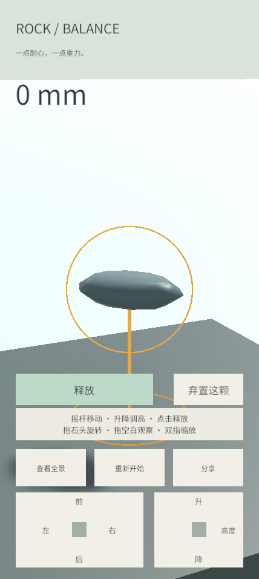
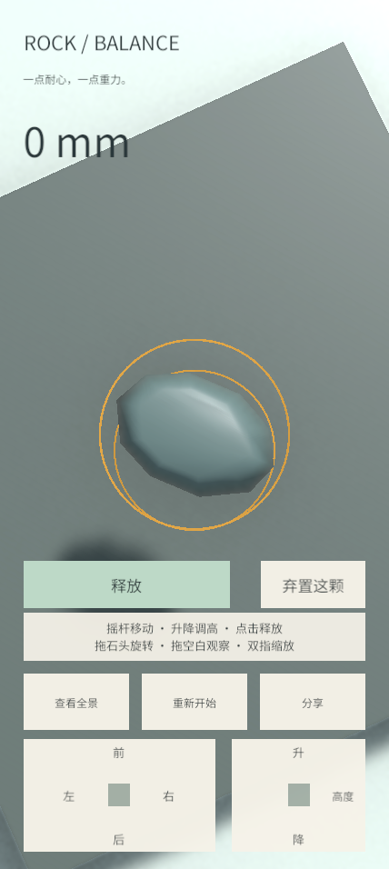
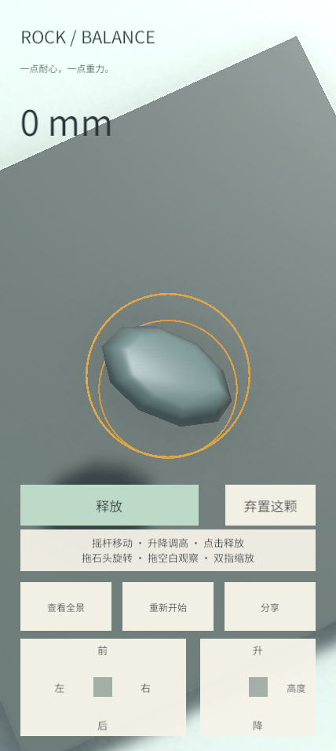

# #24 三维观察验证

日期：2026-11-11。基线：`074147e1e27855c192c99d808c69c30a3092ce8d`。
需求：[实现票 #24](https://github.com/JunduoLiu/RockBalancing/issues/24)、[增量规格 #27](https://github.com/JunduoLiu/RockBalancing/issues/27)。

## 操作与默认参数

普通观察以待摆石头的位置为中心。空白左右拖动水平环绕，上下拖动改变俯角，双指场景手势改变距离；桌面鼠标滚轮也可缩放。拖待摆石头只改变其朝向，空白轻点和结束手势不释放。沿用 #23 的控件触点分配及释放按钮。

| 参数 | 默认值 |
| --- | --- |
| 初始水平朝向 / 俯角 / 距离 | 25° / 16° / 3.8 m |
| 水平环绕 | 完整 360°，角度循环 |
| 俯角范围 | 5°–85°，Inspector 可调，运行时硬限制 0°–89° |
| 缩放范围 | 0.7–40 m，Inspector 可调 |
| 环绕灵敏度 | 0.25° / 像素 |
| 相机净空 | 0.08 m，至少覆盖近裁剪面四角 |

普通观察不再由塔高强制拉远。相机沿观察射线避开石头包围球，并保持近裁剪面高于地面/底座；安全距离优先于缩放请求，放大石头或遮挡物可能使实际距离大于所选距离。包围球使用实际碰撞 bounds，属于保守净空，不改变石头物理。

目标是缓存的位置值，不持有已释放石头作为跟随目标；等待供石或目标移除后仍能环绕该位置。重开恢复初始视角。保留原有调整期间锁定、平滑跟随及全景构图入口，没有开展 #25 的完整输入/换石联动施工。

## 本轮验证

Unity **6000.3.20f1**，用户原有 Editor 中运行 `RockBalancing` Play Mode：**41/41 passed，0 failed、0 skipped**，33.53 s。
分享基础回归 `node --test tools/share.test.cjs`：**9/9 passed**。

新增 6 项并加强现有拖石测试，使用真实 GameBootstrap、EventSystem、鼠标/触控事件及相机外部姿态验证：

- 待摆石头偏离底座轴时，分 8 段完成 360° 环绕，保持距离、对准中心、石头位置与朝向；空白轻点不释放。
- 85° 高角度俯视、5° 下限、边界后立即反向，以及改为 12°–70° 的配置；相机保持正立。
- 缩放上下限可调、近距离及放大石头的净空、低角度环绕时不穿地。
- 双指从待摆石头/场景开始只缩放，不旋转石头或视角；剩余一指不能接续为旋转/环绕。
- 待摆石头被移除后保留视角、仍可观察，重开恢复初始相机姿态。
- 释放后异步等待下一颗，不追逐落石；移除落石后相机保持可用。
- 原有拖石旋转额外检查相机位置和朝向不变。#22 石形/物理、#23 持续摇杆/升降/双手控件/取消/释放、计高、全景和真实分享截图回归均通过。

测试修订说明：双指缩放断言最初在相机 LateUpdate 前读取了上一帧姿态，修正为等待完整帧后验证；首轮未通过的结果没有计为通过。初始化只设置初始观察中心，重开才执行相应输入清理。

## Balance 场景演示

在原 Balance 场景临时进入 Play Mode，通过 Input System 鼠标事件操作，截图为实际 **428 × 956** Game View，包含控件。演示先缩放到 1.5 m，再水平环绕 90°、向上观察至 85°，最后拖石旋转。

| 缩放后侧视 | 水平环绕 90° |
| --- | --- |
|  |  |

| 85° 俯视 | 相同视角拖石旋转 |
| --- | --- |
|  |  |

观察阶段石头位置和朝向均不变；俯角实测 84.99998°。拖石后旋转变化 31.1841°，相机与石头位置不变。截图已逐张检查。

演示后移除临时输入设备，退出 Play Mode；Balance 场景恢复编辑模式，不保存演示状态。既存 `Assets/Resources.meta` 保留且不纳入提交。

## 验证边界

未运行 Web 重构建/重新发布或 iPhone + Chrome 真机验收；公开测试版保持原构建。桌面证据不代替 #26。本 Work 只实现 #24，不启动 #25–26。PR #21 保持草稿、未合并。

Issue 跟踪写入此前已被 GitHub 集成以 403 拒绝；没有新的权限恢复证据，本轮不重复写入或更换身份绕过。交付更新文本另备在 `.scratch/issue24-delivery-record.md`，由主对话或用户在权限恢复后使用。
