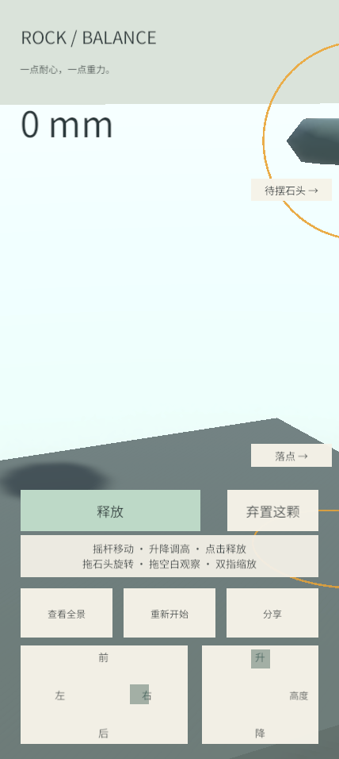
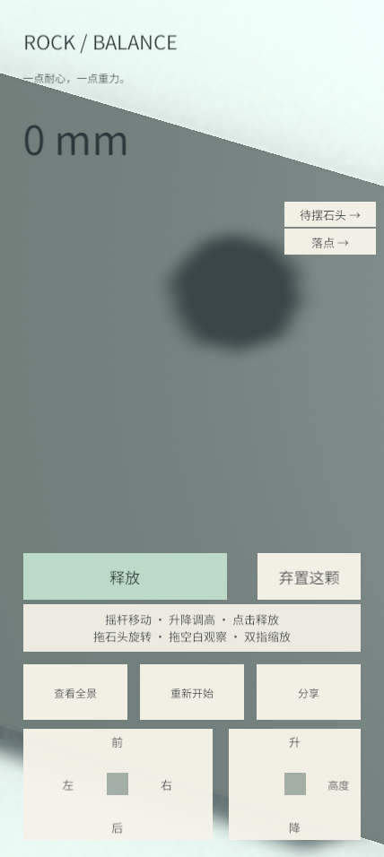
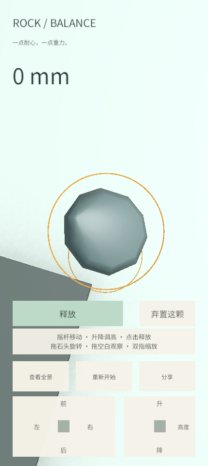
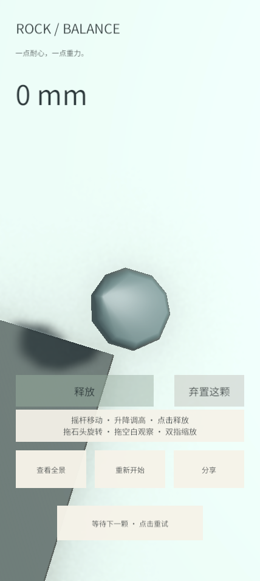
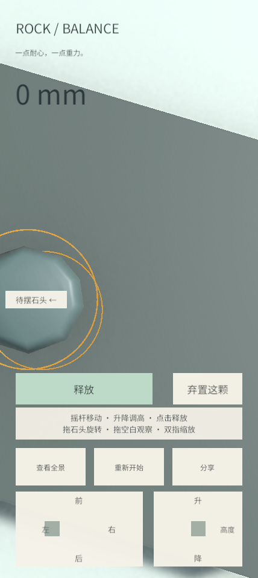
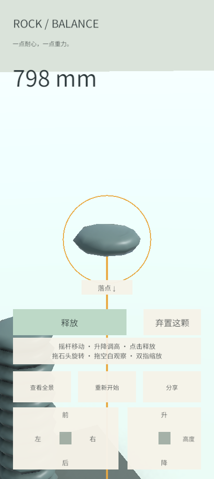
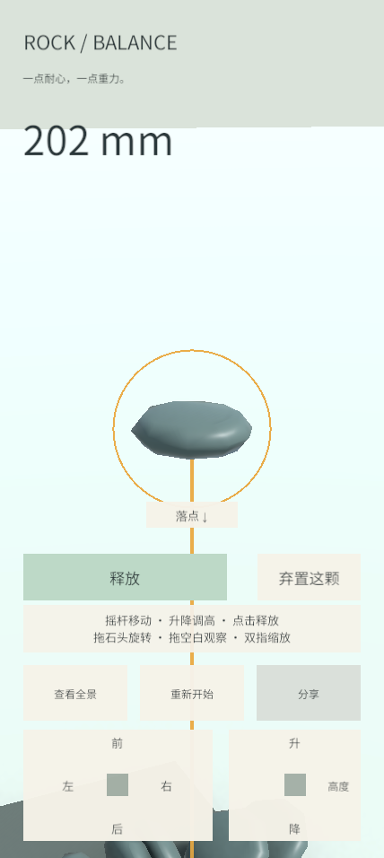

# #25 输入与镜头衔接验证

日期：2026-11-11。基线：`937ff5fdf82ab1ad35f9453ca9eb22156cb833e3`。
需求：[实现票 #25](https://github.com/JunduoLiu/RockBalancing/issues/25)、[增量规格 #27](https://github.com/JunduoLiu/RockBalancing/issues/27)。

## 行为与参数

- 摇杆、升降、拖石旋转期间停止自动居中。空白观察或双指缩放也持有观察中心；松开摇杆但观察手指仍按住时，中心不漂移。缩放剩余的一根手指不能接续为环绕，也不能提前释放中心。
- 所有调整和场景观察手势结束后才恢复居中。默认 `FollowSpeed=2 / s`，使用指数插值 `1-exp(-speed*dt)`，约 0.5 秒消除 63% 的偏移、1.5 秒消除 95%，不因单帧变长直接跳到目标。
- 摇杆使用当帧水平环绕角确定前后左右；俯角和相机净空修正不参与方向计算。保持原有死区 0.12、最大平移 0.35 m/s、升降 0.45 m/s。
- 释放或丢弃清除旧输入；等待供石时保留位置值，不跟随落石。新待摆出现后平滑居中，旧按压不能操控新石头。重开恢复初始观察姿态和输入边界。沿用 #23 的触点起始区域归属与中断处理。
- 落点辅助在输入与相机更新之后刷新，描边至少约 2 个屏幕像素。保留原世界宽度下限：竖线 0.008 m、圆环 0.003 m。
- 近距离连续调整可能把待摆移出固定镜头；此时显示“待摆石头”方向提示。落点在画面外或被操作区覆盖时显示“落点”提示。提示限制在横向 12%–88%、纵向 40%–75% 的操作视区，按实际字体面板宽度额外收进边缘；同处时错开 30 UI 单位。面板和文字均不参与 UI 射线检测，不占用观察触点。无待摆或确认弹窗时隐藏。
- 保留 #24 的 5°–85° 俯角、0.7–40 m 缩放和净空保护。几何净空仍优先于请求距离；本票不移除这项保护。保留已有全景，没有扩展、重做或新增全景专项验收。

## 连续演示

原有 Unity Editor、Balance 场景、实际 **428 × 956** 竖屏帧缓冲，包含 UI。为让等待阶段可见，演示的临时供石器在后续供石前延迟 900 ms，其他输入走真实 Input System 鼠标/触控事件和现有会话入口；该延迟不进入产品代码。

[播放完整连续演示（GIF，94 帧、14.1 秒）](issue-25-continuous.gif)：初始待摆 → 双手移动与升降 → 保持摇杆同时观察至约 84° → 先松摇杆、保持观察中心 → 全部松手平滑居中 → 拖石旋转 → 独立释放 → 稳定等待 → 新待摆平滑切换 → 新按压移动 → 丢弃 → 下一颗 → 重开及重新供石。

| 调整中偏离画面 | 摇杆结束、观察仍持有中心 |
| --- | --- |
|  |  |

| 重新居中后旋转 | 等待供石 |
| --- | --- |
|  |  |

## 高塔与倒塌

临时夹具使用 14 颗固定种子的扁石，逐颗贴近释放并短暂稳定后锁住已释放石头，只为建立可复现的高塔观察现场，不把该夹具当作自然堆叠成功率证据。有效高度约 **798 mm**；待摆偏离中轴 `(0.26, 1.18, -0.12) m`。随后解除夹具约束、施加横向速度造成倒塌。待摆位置、控制权和落点提示保留，倒塌不重开。物理堆叠行为继续由 #22 既有回归验证。

| 高塔、偏离中心 | 解除约束后倒塌 |
| --- | --- |
|  |  |

## 验证范围

最终代码在 Unity **6000.3.20f1** 完整 Play Mode 回归：**47/47 passed，0 failed、0 skipped**，45.84 s。
分享基础回归 `node --test tools/share.test.cjs`：**9/9 passed**。编译与 `git diff --check` 通过。

新增 6 项 Play Mode 行为测试，使用真实 GameBootstrap、EventSystem、Input System 和公开会话入口，不断言私有字段或内部调用次数：

1. 调整与观察同时持有中心，结束后的渐进居中。
2. 85° 俯视时，摇杆方向随当帧水平观察角连续变化；场景触点跨入升降区不会变成控件。
3. 控件触点跨入场景仍不参与缩放；剩余缩放手指、取消和恢复跟随。
4. 释放与丢弃后的延迟供石、稳定等待、平滑目标切换、旧输入失效与重开。
5. 高塔、偏离中心、倒塌后的待摆、控件、落点辅助及远距离线宽。
6. 待摆与落点方向提示、屏幕边界、弹窗隐藏和不拦截场景触控。

原有 #22 物理与扁石、#23 释放与取消/失焦/重开、#24 环绕与净空、计高及分享测试继续包含在完整回归中。

测试修订记录：最初帧末等待在后台 Editor 中停住，已取消该轮并改为普通帧等待；延迟供石测试最初错误地在重开复用同一测试对象，已改为供应新对象；鼠标切换到新建触屏设备的测试补足绑定时间，并在输入生效帧后测量位移。失败或取消轮次不计为通过。演示发现的离屏可见性问题通过方向提示与新增测试解决。

未执行 Web 重新构建/部署或 iPhone + Chrome 真机验收；公开测试版仍为原构建。桌面演示不代替 #26。本 Work 只做 #25，未创建或启动 #26。PR #21 保持草稿且未合并。

截图已逐张检查；演示后移除临时输入设备、退出 Play Mode，恢复原 Balance 编辑场景，不保存演示夹具。

收尾 Editor 为 `ready`、未编译中、场景 `dirty=False`。控制台保留 2 条 Pipeline 的 `HttpListenerResponse disposed` 传输错误，来自 Play Mode 切换后过早发送演示命令；已先核实未有演示运行，再于 Editor 就绪后成功完成最终 94 帧演示。没有游戏脚本编译错误或警告，未清空控制台掩盖这些工具链日志。

GitHub Issue 写入已有 `403 Resource not accessible by integration` 阻塞，没有权限恢复证据，本轮不重复被拒写入或换通道绕过。交付更新文本准备在 `.scratch/issue25-delivery-record.md`，待合法写入权限恢复后使用。既存 `Assets/Resources.meta` 保留，不纳入提交。
