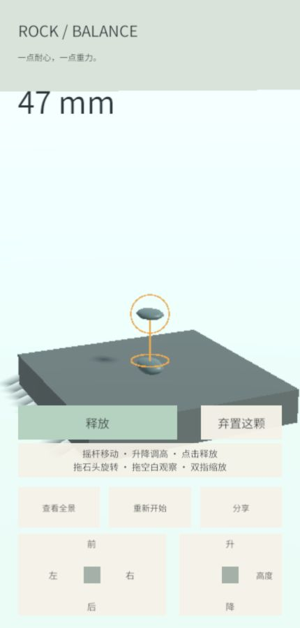
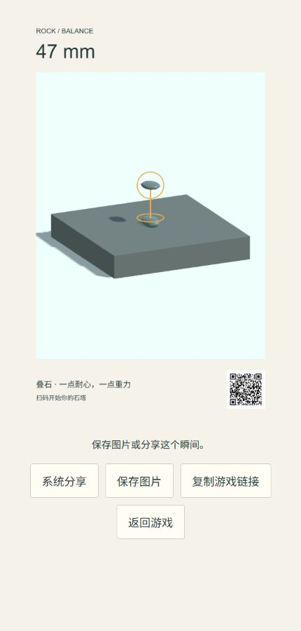

# #26 Web 构建与桌面预检

日期：2026-11-11 UTC。范围：[验收票 #26](https://github.com/JunduoLiu/RockBalancing/issues/26)、[增量规格 #27](https://github.com/JunduoLiu/RockBalancing/issues/27)。本记录是可复核的构建与预检证据，不代表真机验收通过。

## 可试玩构建

- [原公开测试网址](https://rock-balance-playtest-20261110.burblingcrow1.chatgpt.site/)，保持原站点及公开链接访问范围。
- Sites 版本 **2**，发布成功时间 **2026-11-11 05:13:27 UTC**。
- 游戏源码：`0348d9c658c3f6ba6e06a680819fd93d4595fc3c`，包含 #22–25；Unity **6000.3.20f1**。
- 站点源提交：`36176eb10d4d47150ac21ffeafe894ace647ec48`。
- [线上构建元数据及资产哈希](https://rock-balance-playtest-20261110.burblingcrow1.chatgpt.site/build-info.json)。本机原产物位于 `Builds/Web`。
- WebAssembly 压缩文件 SHA-256：`51862bbbf6ac239ffa68c80456833f555e43820f1b086391421a24fbaa08ac73`。

## 本轮验证结果

| 检查 | 结果 |
| --- | --- |
| Unity 完整 RockBalancing Play Mode | **passed**：47/47，0 failed、0 skipped，45.81 s |
| 分享桥接 `node --test tools/share.test.cjs` | **passed**：9/9 |
| 完整 Web 构建 | **passed**：Succeeded，0 errors、0 warnings，214.45 s，17,059,306 bytes |
| 本地网页产物与压缩 | **passed**：8 个文件齐全，页面引用均存在，Gzip 可解压，Wasm 文件头有效，loader 包含解压回退 |
| 线上资源 | **passed**：8 个资源均 HTTP 200；7 个资源 SHA-256 一致，首页仅额外注入 Cloudflare challenge-platform 脚本，移除该平台片段后原 HTML 字节一致 |
| 压缩响应与实际加载 | **passed**：`.unityweb` 返回 application/octet-stream、无 Content-Encoding，Unity 回退解压成功；JS 正确作为 JavaScript 发送。无压缩响应头的本机 HTTP 服务也成功加载 |
| 桌面操作预检 | **passed**：持续摇杆、独立升降、拖石旋转、上下/水平观察、独立释放、供石及丢弃换石；未观察到误释放、明显穿透或镜头跳变 |
| 桌面基本回归 | **passed**：本地释放后 36 mm；线上贴近释放后 47 mm；显示 stablizing 后恢复高度；分享图配对高度和完整现场，确认重开后 0 mm 与初始视角 |
| 实际分享图/二维码 | **passed**：线上下载 PNG 为 900×1440，独立 zxing-cpp 解码得到原公开游戏地址；复制链接按钮显示成功反馈 |
| 浏览器 warn/error | **passed**：预检捕获记录为空 |

桌面环境：HPC Windows，ChatGPT 内置桌面浏览器，430×900 竖屏视区，鼠标操作。浏览器版本未采集；**这不是实际 iPhone，也不是 Chrome 真机结果**。未尝试向第三方发送分享内容。手机多指、原生系统分享成功/取消与移动浏览器体验留待实际设备反馈。

| 线上释放后 47 mm | 同次高度的分享图 |
| --- | --- |
|  |  |

## Unity 与现场保护

使用原有 Editor，没有另开、关闭或重启 Editor。构建后状态为 ready、Play Mode stopped、未编译中、无脏场景。既存 `Assets/Resources.meta` 保留且不纳入提交，SHA-256 仍为 `336f317be84cb77b2cc2198a64e3c6752efb27441fb9536b5c4300e9952b8908`。自动生成的 PerformanceTestRun 资源由 Unity 构建清理流程移除。

没有主动清空控制台。开工前两条错误是 Pipeline 的 `editor`/`editor-status` 命令名称错误；本轮查询说明时另有 `help`/`unity command` 名称错误。构建调用连接在 55 s 超时后，Unity 继续构建，结束时产生两条 Pipeline HTTP 回包错误（连接中止、headers already sent）。构建成功依据为新的结果文件、Unity BuildReport、产物时间/哈希和实际加载，不依赖该超时调用的返回值。收尾控制台 groundTruth 仍为 **2 errors**，对应上述回包错误，compilationFailed=false；不可描述为控制台干净。

## 手机最小检查方法

用实际 iPhone 的 Chrome 打开上方链接并刷新；没有固定时长或颗数门槛。

1. **堆叠体验**：连续贴近摆放几颗扁石，判断是否更容易放稳；再升高一颗释放，确认仍会扰动塔体。
2. **操作闭环**：摇杆移动、升降、拖石旋转、空白三维观察、释放和换石连贯操作；尝试双手移动/升降，观察有无误释放、明显穿透或镜头跳变。
3. **基本回归**：检查高度；生成分享图，检查高度、完整现场、二维码及保存/系统分享；返回游戏并确认重开。

请记录：构建版本 **2 / 0348d9c**、iPhone 型号、iOS/Chrome 版本，三项各为 **passed / failed / not run**；失败时补操作顺序和现象，可附截图或录屏。尚无实际用户结果，三项均 **not run**。不关闭 #26、不勾选真机通过，不宣称旧 #20 全部设备验收完成。

## 交付边界

没有修改游戏代码。此票仅提交构建/预检文档与截图，发布到既有测试站点；PR #21 保持 draft、未合并。仓库无 CI 工作流，不把本地回归称为 CI 通过。

GitHub Issue 写入此前被集成以 `403 Resource not accessible by integration` 拒绝；没有新的权限恢复证据，本轮没有重试、改用身份或通道。供手动更新的交付文本在 `.scratch/issue26-delivery-record.md`。等待手机结果期间停止主动工程，不启动其他票。
