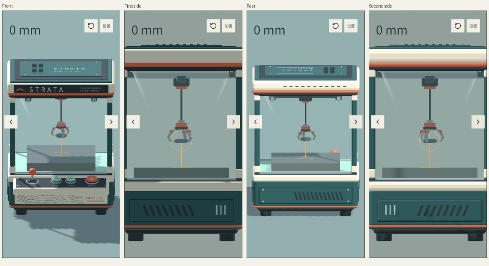

# STRATA 街机网页版验收记录

2026-11-18。Unity 6000.3.20f1 从游戏提交 `9ae7b7c` 构建原版和街机版。原版入口为 `/`，街机版为 `/arcade/`。`cddf716` 仅调整测试观察帧。玩法和验收条件见[规格 #36](https://github.com/JunduoLiu/RockBalancing/issues/36)。

| 验证 | 结果 |
| --- | --- |
| Unity Play Mode | 90 项通过，0 项失败或跳过。覆盖共享堆叠物理、四面权限、双指互斥、三轴正反向、15° 与 30° 步长、碰撞时整格回退，以及高塔上的供石与夹持。 |
| 浏览器输入与分享 | 19 项脚本测试通过。Chromium 在 430 × 900 和 900 × 430 两个视口以触摸事件操作本地 WebGL 构建，两个网址均直接进入对应玩法。 |
| 正面与侧窗 | 静按摇杆球心时待摆石头位置保持。用另一指触碰隐藏箭头的位置时镜头锁定。四次同向换窗回到正面。横屏侧窗内能看到首次放置的底座上缘及间隙，横竖屏切换后仍保持取景。 |
| 旋转 | 默认自由旋转。开关刻度时姿态保持。按住显示三环，长拖与短拖各转一格；松手再向反方向拖动可以退回。 |
| 释放与供石 | 释放后 130 毫秒完成换面。侧窗在第 178 毫秒拍到同一块石头仍在空中，随后落在底座上，下一颗由钩爪夹持。这一轮显示 43 mm。 |

首次发布使用的域名在加载游戏前遇到 Cloudflare 拦截。同一份构建随后发布至 GitHub Pages。未登录的 Chrome 已直接打开两个入口，两套游戏的加载器、框架、数据和 WebAssembly 文件均返回 HTTP 200。街机版线上试玩时释放石头并切到侧窗，本轮显示 44 mm，钩爪已夹住下一颗。[街机版](https://xybuilds.github.io/strata-rock-arcade/arcade/) · [原版](https://xybuilds.github.io/strata-rock-arcade/)。

2026-11-18，用户确认公开试玩通过。用户未提供验收设备型号或浏览器版本。
