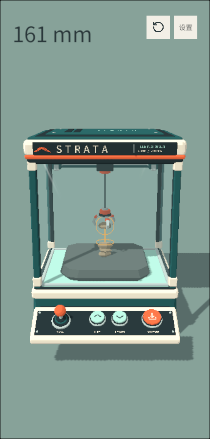
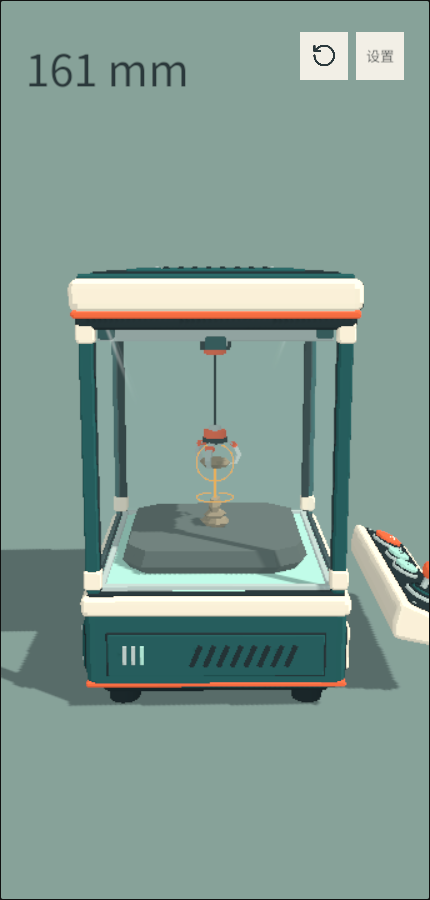
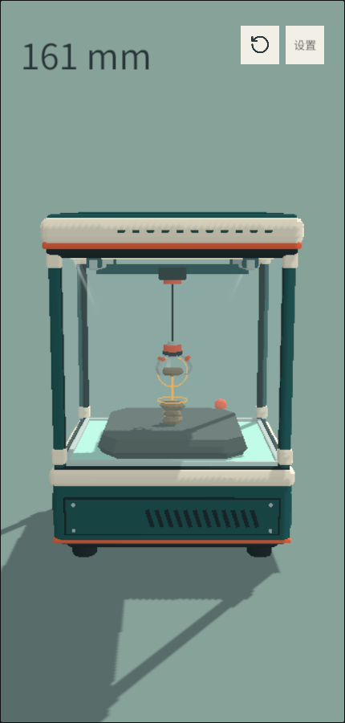
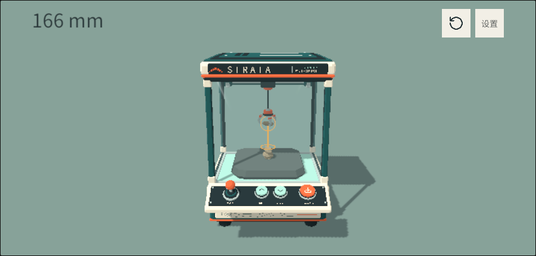
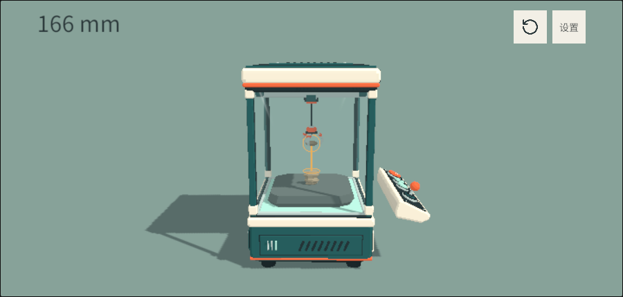
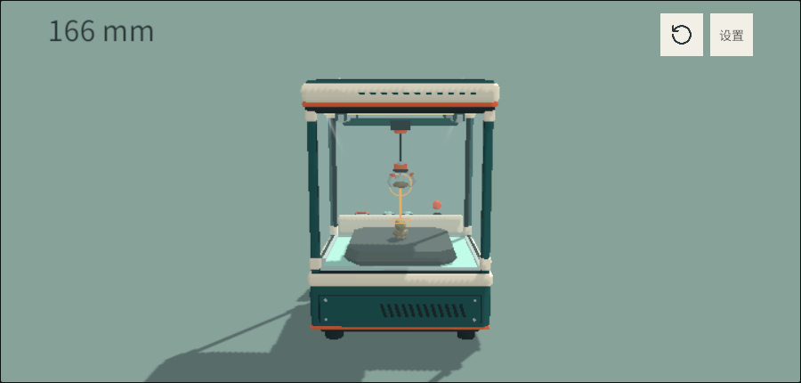

# STRATA 街机版 #42 验收记录

2026-11-19。Unity 6000.3.20f1，游戏代码提交 `2c318fb`，对照基线为上一版已验收的 `ab76a06`。[规格 #42](https://github.com/JunduoLiu/RockBalancing/issues/42) · [集成 PR #49](https://github.com/JunduoLiu/RockBalancing/pull/49)

## 游戏内验收

| 场景 | 结果 |
| --- | --- |
| Play Mode | 完整运行 103 项，103 项通过，0 项失败或跳过。其中 29 项覆盖街机场景，74 项覆盖原有玩法和共享逻辑。运行耗时 108 秒。 |
| 镜头与主仓 | 测试在横屏和竖屏检查标准供石点、固定镜距和一个原始仓高的可见范围。高于 2 米的塔倒塌后，回落中间帧仍能看见仓顶。已选释放高度在可用范围内得到保留。 |
| 环绕与控制台 | 来回越过半圈后松手，均沿短弧回正。旧按钮位置显露的空白处可以接续环绕，回正途中的可见按钮不能接续环绕或触发摆放。另一根手指按住控件跨过回正时刻，须重新按下才响应。 |
| 待摆石头 | 自由、15° 和 30° 三种模式可从街机设置选择。测试覆盖三轴跨格、同一手势反拖、中间步碰撞时停格、切换姿态保持。宽平面朝下释放后，接触位置与碰撞面吻合。 |
| 美术 | 分档着色覆盖机柜、控制台、钩爪、石头、底座、地台、玻璃和环境。直接采样渲染画面检查同一明暗档的石面以及阴影里石头和底座之间的色差。 |
| 浏览器输入与分享 | 19 项浏览器脚本测试全部通过，覆盖输入焦点、按键状态清除，以及分享预览、取消和重试。 |

Play Mode 使用实际街机场景及模拟触摸、鼠标和键盘。早期批处理运行中，编辑器焦点使部分模拟输入未送到 Game View。最终完整运行将测试设备输入路由到 Game View，结束时恢复编辑器设置。该临时配置未进入游戏构建。

## WebGL 试玩

用同一代码构建普通版和街机版，从本地 HTTP 服务打开两个入口。在桌面 Chromium 浏览器中通过触摸事件操作 **430 × 900** 和 **900 × 430** 两个视口。每个视口的三张画面来自同一局，分别在正面堆石后、按住侧面和按住背面时截取。两局分别随机生成石头。

| 正面 | 侧面 | 背面 |
| --- | --- | --- |
|  |  |  |
|  |  |  |

两局绕机前分别显示 161 mm 和 166 mm。侧面和背面保持各自的读数，回正后的整幅画面与绕机前逐像素一致。重新按下释放键后，两局读数都发生了变化。设置中也实际点选了 30°。[旋转设置截图](issue-42/rotation-settings.png)普通版在两个视口都完成了释放与打开分享预览。此次浏览器验证使用桌面设备模拟触摸。手机硬件上的帧率和手感仍需单独试玩。
